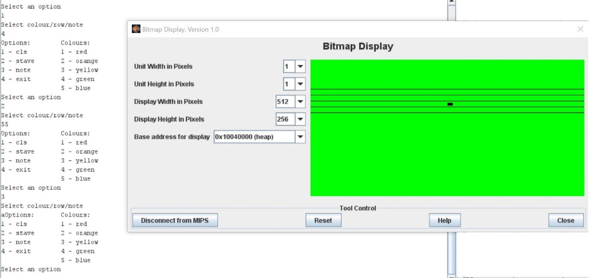

# Assembly Stave and Note Renderer

A MIPS assembly program that draws a musical stave, displays note markers, and plays individual notes through MIDI in the MARS simulator. Choose a background color, position a five-line stave, and enter notes from `A` to `G` through a text menu.

Start with [music_stave.asm](music_stave.asm), the complete interactive program. The other assembly files are separate demos of its drawing components.

## Table of Contents

- [Overview](#overview)
- [Preview](#preview)
- [Repository Files](#repository-files)
- [Requirements](#requirements)
- [Install Java](#install-java)
- [Download MARS](#download-mars)
- [Download This Project](#download-this-project)
- [Configure MARS](#configure-mars)
- [Configure the Bitmap Display](#configure-the-bitmap-display)
- [Run the Main Program](#run-the-main-program)
- [Menu and Input Guide](#menu-and-input-guide)
- [Example Session](#example-session)
- [Run the Separate Demos](#run-the-separate-demos)
- [How the Program Works](#how-the-program-works)
- [Troubleshooting](#troubleshooting)
- [Reference Documentation](#reference-documentation)
- [License](#license)

## Overview

The program combines memory-based graphics with console input and MIDI output. A stave (also called a staff) is a group of five horizontal lines used to position musical notes.

The main program lets you:

- Fill the display with red, green, orange, or violet.
- Draw five white horizontal lines at a selected starting row.
- Draw a black rectangular note marker and play its corresponding pitch.
- Repeat the menu to add notes or redraw the display.
- Exit using menu option `4`.

MIPS is the processor instruction set used by the source files. Install MARS to assemble and simulate those instructions on your computer. No physical MIPS processor, native compiler, external graphics library, or separate MIDI player is required.

## Preview



This reference image illustrates the display layout and tool settings. Its menu, color numbering, and dark stave lines differ from this repository's main program. Follow the controls below: green is color `2`, notes use uppercase letters, and the main program draws white stave lines.

## Repository Files

| File | Purpose |
| --- | --- |
| [music_stave.asm](music_stave.asm) | Complete interactive program: background colors, stave drawing, note markers, MIDI playback, and exit. Start here. |
| [CLS+STAVE.asm](CLS%2BSTAVE.asm) | Combined background and stave demo. Draws blue lines. Its unfinished note branch only reads an integer. |
| [Stave.asm](Stave.asm) | Standalone five-line blue stave demo. Reads a vertical offset, calls its drawing procedure, and exits. |
| [Rectangle.asm](Rectangle.asm) | Standalone note demo. Reads one uppercase letter, draws a white rectangle, plays a tone, and reaches the end of the file. |
| [assets/bitmap-display.jpg](assets/bitmap-display.jpg) | Reference screenshot displayed above. |
| [README.md](README.md) | Setup, execution, and usage instructions. |
| [LICENSE](LICENSE) | MIT license for the repository. |

The assembly files are independent programs. Open and assemble one file at a time; do not assemble them together.

## Requirements

| Requirement | Purpose |
| --- | --- |
| Windows, macOS, or Linux with a graphical desktop | Runs the simulator interface and Bitmap Display. |
| Java | Runs the MARS executable JAR. A Java 8 JDK is a conservative starting choice for this legacy simulator. |
| Original MARS 4.5 | Provides the assembler, Bitmap Display, and MIDI service. |
| Speakers or headphones | Lets you hear the notes. Graphics can still be inspected without audio. |
| Git (optional) | Provides an alternative to downloading the repository as a ZIP. |

Use the graphical MARS application for the full experience. SPIM and QtSPIM do not provide the MARS-specific MIDI syscall used here. See the [official syscall documentation](https://dpetersanderson.github.io/Help/SyscallHelp.html).

## Install Java

If Java is already installed, open PowerShell, Command Prompt, or a terminal and run:

```text
java -version
```

If this prints a Java version, try launching MARS before installing anything else. If Java is missing, install a desktop JDK.

### Windows

1. Open the [Eclipse Temurin downloads page](https://adoptium.net/temurin/releases/?version=8).
2. Select Java `8`, Windows, your CPU architecture (usually `x64`), and package type `JDK`.
3. Download the `.msi` installer and run it.
4. Enable the option to add Java to `PATH`. You can also enable `JAVA_HOME`.
5. Complete installation and open a new terminal.
6. Run `java -version` again.

See [Temurin's Windows installation guide](https://adoptium.net/installation/windows) for installer options.

### macOS

1. On the [Temurin downloads page](https://adoptium.net/temurin/releases/?version=8), select macOS and an architecture compatible with your Mac.
2. Download an available JDK `.pkg` installer and complete installation.
3. Open a new Terminal window and run `java -version`.

### Linux

1. Follow the [official Temurin Linux package instructions](https://adoptium.net/installation/linux) for your distribution.
2. Install a desktop JDK, such as `temurin-8-jdk`, using the configured package manager.
3. Open a terminal and run `java -version`.

Use Java with graphical support; a headless-only installation cannot show MARS windows. Other methods are listed in the [Temurin installation documentation](https://adoptium.net/installation/).

## Download MARS

1. Open the [official MARS releases page](https://github.com/dpetersanderson/MARS/releases).
2. Find the MARS 4.5 release and expand **Assets** if needed.
3. Download the executable `.jar` asset. Do not choose the automatically generated source ZIP or TAR archive.
4. Save it in an easy-to-find folder, such as `Downloads/MARS`.
5. Rename the downloaded JAR to `Mars.jar` for the commands below.
6. Open a terminal in that folder and run:

   ```text
   java -jar Mars.jar
   ```

7. The MARS editor should open. Double-clicking the JAR also works if your system associates JAR files with Java.

No additional MARS installation or extraction is needed. See the [official MARS launch instructions](https://dpetersanderson.github.io/download.html).

If your terminal is in another folder, supply the full path in quotes:

```text
java -jar "C:\path\to\Mars.jar"
```

On macOS or Linux, use the corresponding path, for example:

```text
java -jar "/home/your-name/Downloads/MARS/Mars.jar"
```

## Download This Project

### Option 1: Download a ZIP

1. Open the [project repository](https://github.com/sahasatyaki/Assembly-Stave-and-Note-Renderer).
2. Select **Code > Download ZIP**.
3. Extract the ZIP into a folder of your choice.
4. Locate `music_stave.asm` in the extracted folder. Open the extracted file rather than a file inside the ZIP.

### Option 2: Clone with Git

1. If needed, install Git from [git-scm.com](https://git-scm.com/downloads).
2. Open a terminal in the folder where you want the project.
3. Run:

```bash
git clone https://github.com/sahasatyaki/Assembly-Stave-and-Note-Renderer.git
cd Assembly-Stave-and-Note-Renderer
```

Java and MARS are separate downloads and are not bundled with this repository. There is no dependency installation or build command for the project itself.

## Configure MARS

Launch MARS and check these options in **Settings**:

| Setting | Required value |
| --- | --- |
| Permit programs to use extended (pseudo) instructions and formats | Enabled |
| Assemble applies to all files in directory | Disabled |
| Assemble and execute programs using delayed branching | Disabled |
| Memory Configuration | Default |
| Popup Dialog for input syscalls | Disabled for the Run I/O instructions below |

The code uses extended instruction forms and assumes execution without branch delay slots. Several files reuse label names, so assembling the whole folder causes conflicts. Keep the default memory layout because display addresses are fixed in the code. MARS remembers settings between sessions. See the [official settings guide](https://dpetersanderson.github.io/Help/MarsHelpSettings.html).

## Configure the Bitmap Display

1. Select **File > Open** and choose `music_stave.asm`.
2. Select **Run > Assemble**.
3. Select **Tools > Bitmap Display**.
4. Set these values exactly:

   | Bitmap Display field | Value |
   | --- | --- |
   | Unit Width in Pixels | `1` |
   | Unit Height in Pixels | `1` |
   | Display Width in Pixels | `512` |
   | Display Height in Pixels | `256` |
   | Base address for display | `0x10040000 (heap)` |

5. Click **Connect to MIPS**. The button changes to **Disconnect from MIPS** when connected.
6. Keep this window open and position it so you can also see MARS's **Run I/O** tab.

The display observes writes to simulated memory. Connect it before drawing so it receives those writes. Its controls and address handling are implemented in the [MARS Bitmap Display source](https://github.com/dpetersanderson/MARS/blob/main/mars/tools/BitmapDisplay.java).

## Run the Main Program

1. Complete the setup above.
2. Confirm that `music_stave.asm` is selected and has assembled successfully.
3. Set the run speed slider to its fastest setting for responsive drawing.
4. Select **Run > Go**.
5. Click the **Run I/O** tab at the bottom of the main MARS window.
6. At each prompt, enter just the requested value and press Enter. Use one response per prompt.
7. Enter operation `1`, then color `2`, to fill the display green.
8. Enter operation `2`, then starting row `55`, to draw the stave.
9. Enter operation `3`, then uppercase `A`, to draw and play a note.
10. Continue selecting operations, or enter operation `4` to finish.

Input goes into **Run I/O**, not the Bitmap Display or the terminal used to launch Java. If input popups are enabled instead, submit each value in the popup dialog.

To restart, select **Run > Reset**, check that the Bitmap Display is connected, then select **Run > Go**. Fill the background again to repaint the display. Use **Run > Stop** to stop execution manually.

## Menu and Input Guide

### Operation selection

| First input | Operation | Next input |
| --- | --- | --- |
| `1` | `cls`: fill the background and erase drawings | A color number from `1` to `4` |
| `2` | `stave`: draw five white horizontal lines | An integer starting row |
| `3` | `note`: draw a black marker and play a tone | One uppercase letter from `A` to `G` |
| `4` | `exit`: terminate the program | None |

The shared second prompt says `Enter Your Choice for Colour/Row/Note`. Its meaning depends on the operation selected.

### Background colors

| Color input | Color | Stored RGB value |
| --- | --- | --- |
| `1` | Red | `0xFF0000` |
| `2` | Green | `0x00FF00` |
| `3` | Orange | `0xFF8C00` |
| `4` | Violet | `0x9400D3` |

`cls` fills the entire display. If you clear after drawing the stave or notes, draw them again.

### Stave starting row

Rows start at `0` at the top and increase downward. For starting row `R`, the five lines appear at `R`, `R + 11`, `R + 22`, `R + 33`, and `R + 44`. Each line is one pixel tall and 512 pixels wide, with ten empty rows between lines.

Use a starting row from `0` to `211` to keep all five lines inside the 256-pixel display. For a first run, use `55`. The input controls vertical position, even where a demo's prompt refers to "gaps".

### Notes and sound

Enter one uppercase letter, such as `A`, when operation `3` asks for a note. Draw a stave first: the main program remembers its most recent starting row and uses it to position note markers.

| Note input | MIDI pitch | Marker's top row relative to the stave |
| --- | --- | --- |
| `A` | `69` | `R + 25` |
| `B` | `71` | `R + 19` |
| `C` | `72` | `R + 14` |
| `D` | `74` | `R + 8` |
| `E` | `76` | `R + 3` |
| `F` | `65` | `R + 36` |
| `G` | `67` | `R + 30` |

Each marker is 8 pixels wide and 6 pixels tall. Each letter has a fixed horizontal position, so repeating a letter redraws the same marker. Different notes remain visible until cleared.

The program requests a 1,000-millisecond tone with instrument value `7` and volume value `100`. Synchronous MIDI syscall `33` returns after playback finishes. Java's MIDI implementation produces the sound; see the [MARS MIDI syscall reference](https://dpetersanderson.github.io/Help/SyscallHelp.html).

## Example Session

Enter these values individually as each prompt appears:

| Step | Input | Result |
| --- | --- | --- |
| 1 | `1` | Select background fill. |
| 2 | `2` | Fill the display green. |
| 3 | `2` | Select stave drawing. |
| 4 | `55` | Draw white lines at rows 55, 66, 77, 88, and 99. |
| 5 | `3` | Select note drawing and playback. |
| 6 | `A` | Draw a black A marker and play its tone. |
| 7 | `3` | Select another note. |
| 8 | `C` | Add a C marker and play its tone. |
| 9 | `4` | Exit. |

For more notes, repeat operation `3` followed by a supported letter. Wait for playback and the next prompt before entering another operation.

## Run the Separate Demos

Keep the same MARS settings and Bitmap Display configuration. Stop any running program, open the chosen demo, assemble only that file, connect the display, and select **Run > Go**.

### CLS+STAVE.asm

- Select operation `1`, then color `1` to `4`, to fill the background.
- Select operation `2`, then starting row `55`, to draw five blue lines.
- Colors and line spacing match the main program's choices and spacing.
- Operation `3` is unfinished: it asks for an integer, reads it, and reaches the end without drawing a note or playing sound.
- Although its menu lists exit option `4`, the implementation exits through the fallback for any operation other than `1`, `2`, or `3`.

### Stave.asm

- Enter one integer at the `Enter the number of gaps` prompt.
- The integer shifts the stave vertically; it does not change spacing between lines.
- The starting address is `0x10045000`, ten display rows below the heap base. Input `0` draws blue lines at rows 10, 21, 32, 43, and 54.
- Use input `0` to `201` to keep the entire stave visible.
- The program returns from its drawing procedure and exits. Reset and run again for another position.

### Rectangle.asm

- Enter one uppercase letter from `A` to `G`.
- The demo draws a white 8-by-6-pixel marker and plays the same pitch as the main program.
- Its drawing buffer starts at the default static data base. Its initial offset of 96 rows places the marker in the heap-based display region.
- It draws no stave and fills no background. After the tone, execution reaches the end of the file. Reset and run again to try another note.

## How the Program Works

### Bitmap memory

The Bitmap Display treats each aligned 32-bit word as a pixel. The source writes colors with `sw`, using RGB values in the low 24 bits.

Each row occupies `512 * 4 = 2048` bytes. A pixel at column `x` and row `y` corresponds to:

```text
pixel_address = 0x10040000 + (y * 2048) + (x * 4)
```

The visible 512-by-256 display occupies `0x80000` bytes. Background loops write from `0x10040000` up to, but excluding, `0x100C0000`.

### Stave drawing

The main program multiplies the selected row by 2048, adds the heap display base, and writes 512 white pixels. After each line, it skips ten rows before drawing the next. Five repetitions produce the stave.

### Note drawing

The note routine selects a pitch and coordinates, then draws a rectangle with nested horizontal and vertical loops. It scales horizontal coordinates by four bytes and vertical coordinates by 2048 bytes.

In `music_stave.asm`, `ReserveSpace` follows the prompt strings in static data. Under the default memory configuration its address is `0x100100BC`. The initial 96-row offset compensates for the distance from the static data base to the heap display base. The preceding strings also shift visible horizontal positions by 47 pixels relative to the constants in the note branches. The heap base remains the required Bitmap Display setting even though this routine uses `ReserveSpace`.

### Input and playback

| MARS syscall | Purpose |
| --- | --- |
| `4` | Print menus and prompts. |
| `5` | Read integer operation, color, and row selections. |
| `12` | Read one note character. |
| `33` | Play a MIDI tone and wait for it to finish. |
| `10` | Exit. |

## Troubleshooting

| Problem | What to check |
| --- | --- |
| `java` is not recognized or cannot be found | Install Java with its PATH option, open a new terminal, and check `java -version`. |
| `Unable to access jarfile` | Check the JAR filename and current folder. Use a quoted full path if necessary. |
| Double-clicking the JAR opens an archive viewer | Launch with `java -jar Mars.jar` from a terminal. |
| No window appears, or a headless error appears | Use a graphical desktop and Java with desktop support. |
| Duplicate label errors during assembly | Disable **Assemble applies to all files in directory** and assemble only the selected file. |
| Instructions are rejected | Enable extended instructions and formats, and use original MARS 4.5. |
| The display is blank or incomplete | Check all five display values, connect before drawing, and fill the background again. |
| Lines or notes appear at unexpected positions | Keep default memory configuration, width 512, unit size 1, and heap base `0x10040000`. Use row `55` for the main program. |
| No note marker appears | Draw the stave first, choose operation `3`, and enter one uppercase letter. Use `music_stave.asm`; the combined demo has no note implementation. |
| No sound is heard | Check volume and the audio output device. Confirm you are using MARS and Java can access a MIDI synthesizer. |
| The menu pauses after a note | The MIDI call waits for the requested one-second tone before returning. |
| The program exits after input | Check the operation number and note letter. Unsupported values terminate instead of displaying an error menu. |
| Old drawings remain after restarting | Reconnect if needed, run the program, and use operation `1` to repaint the background. |

## Reference Documentation

- [Original MARS repository and releases](https://github.com/dpetersanderson/MARS)
- [MARS download and launch instructions](https://dpetersanderson.github.io/download.html)
- [MARS settings](https://dpetersanderson.github.io/Help/MarsHelpSettings.html)
- [MARS syscall and MIDI documentation](https://dpetersanderson.github.io/Help/SyscallHelp.html)
- [MARS Bitmap Display implementation](https://github.com/dpetersanderson/MARS/blob/main/mars/tools/BitmapDisplay.java)
- [Eclipse Temurin Java downloads](https://adoptium.net/temurin/releases/?version=8)
- [Eclipse Temurin installation guides](https://adoptium.net/installation/)
- [Git downloads](https://git-scm.com/downloads)

## License

This repository is distributed under the [MIT License](LICENSE). See the license file for its full terms.